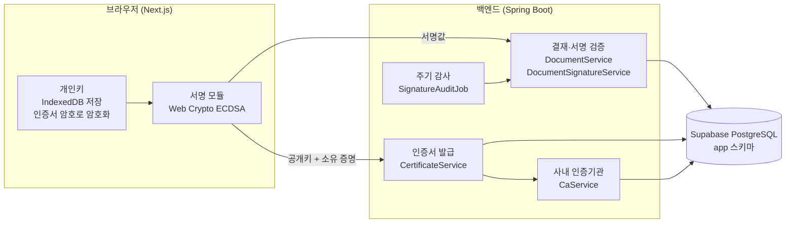
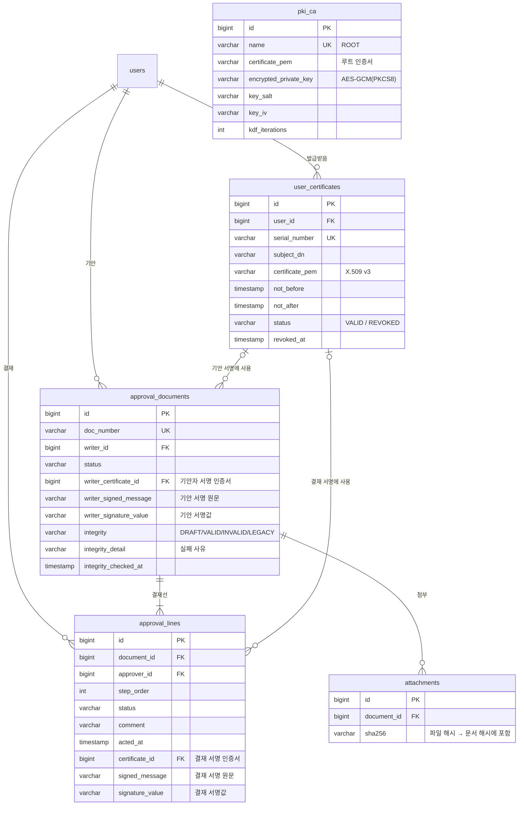
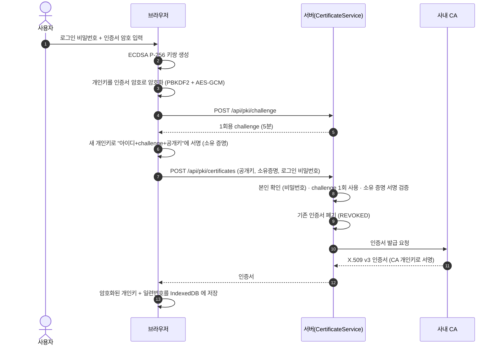
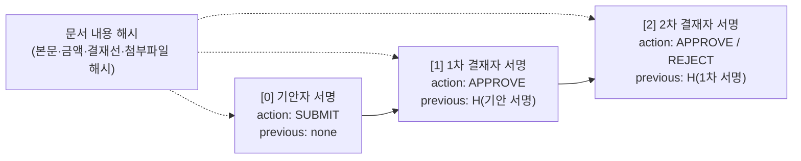
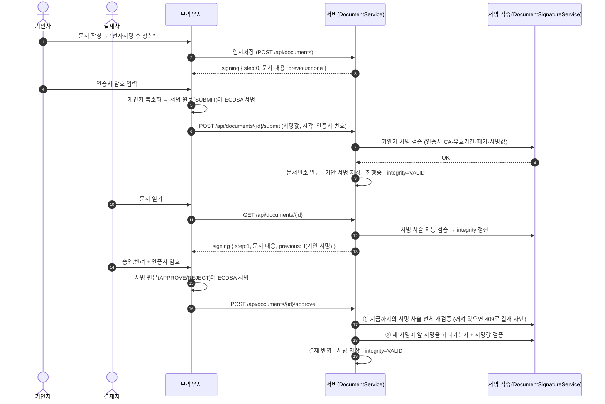

# 인증서 기반 전자서명 결재 — 설계서

> 전자결재 시스템 캡스톤 프로젝트 · 결재 = 결재자의 전자서명을 문서에 차례로 추가하는 것

## 1. 설계 목표

| 요구사항 | 설계 |
|---|---|
| 인증서 기반 전자서명으로 결재 | 상신·승인·반려 모두 X.509 인증서(ECDSA P-256)의 개인키로 서명해야만 처리된다. 서명이 없거나 검증에 실패하면 서버가 거부한다. |
| 인증기관(CA) 구축 | 사내 루트 CA를 두고, 본인 확인과 개인키 소유 증명을 거쳐 사용자에게 X.509 v3 인증서를 발급한다. |
| 결재 = 전자서명 추가 | **기안자 서명 → 1차 결재자 서명 → 2차 …** 순서로 서명이 쌓인다. 각 서명은 바로 앞 서명의 해시를 포함하는 **서명 사슬**이다. |
| 전자서명값 관리 필드 | 문서(기안자 서명)와 결재선(결재자 서명)에 인증서·서명 원문·서명값 필드를 두고, 인증서·CA 테이블을 추가한다. |
| 문서 유효성 = 서명 검증, 자동 처리 | 결재할 때, 문서를 열 때, 30분마다 주기 감사할 때 서명 사슬 전체를 자동으로 다시 검증하고 결과를 문서의 무결성 필드에 기록한다. |

## 2. 전체 구조



- **개인키는 서버로 가지 않는다.** 브라우저에서 만들고, 인증서 암호(PBKDF2 60만 회 + AES-256-GCM)로 암호화해서 IndexedDB에 저장한다.
- 서버는 공개키(인증서)로 **검증만** 한다. 그래서 서버 관리자도 결재자 서명을 만들어 낼 수 없다.

## 3. 데이터 모델 (ERD)



**추가된 전자서명 필드**

| 테이블 | 필드 | 의미 |
|---|---|---|
| `approval_documents` | `writer_certificate_id`, `writer_signed_message`, `writer_signature_value` | 기안자 서명 (사슬의 첫 고리) |
| `approval_documents` | `integrity`, `integrity_detail`, `integrity_checked_at` | 서명 사슬 자동 검증 결과 |
| `approval_lines` | `certificate_id`, `signed_message`, `signature_value` | 결재자 서명 |
| `user_certificates` | (테이블 신설) | 사용자 인증서와 폐기 상태 |
| `pki_ca` | (테이블 신설) | 루트 CA 인증서와 암호화된 CA 개인키 |

## 4. 인증기관(CA)과 인증서

| 항목 | 값 |
|---|---|
| 알고리즘 | ECDSA P-256 / SHA-256 (`ecdsa-with-SHA256`) |
| 루트 CA | `CN=E-Approval Root CA, O=E-Approval, C=KR`, 10년, `basicConstraints CA:TRUE pathlen:0`, `keyUsage keyCertSign, cRLSign` |
| 사용자 인증서 | `CN=이름, OU=부서, UID=아이디`, 1년, `CA:FALSE`, `keyUsage digitalSignature, nonRepudiation`, SKI/AKI 포함 |
| 일련번호 | 128비트 난수 |
| CA 개인키 보관 | `CA_KEY_PASSWORD`로 PBKDF2-HMAC-SHA256(31만 회) → AES-256-GCM 암호화 후 DB 저장 |
| 구현 | 외부 라이브러리 없이 JDK 표준 API. X.509 DER 인코딩은 `pki/crypto/Der.java`에서 직접 구현 |

### 인증서 발급 흐름



## 5. 결재 = 서명 사슬



- 모든 서명은 **같은 문서 내용 해시**에 서명한다. 따라서 결재 후 내용이 바뀌면 모든 서명이 깨진다.
- 각 서명은 **바로 앞 서명의 해시**를 포함한다. 따라서 중간 서명을 빼거나 바꾸면 뒤의 서명이 모두 깨진다.
- 결과적으로 "2차 결재자는 기안 내용과 1차 승인을 확인한 뒤 승인했다"는 **순서까지 증명**된다.

### 서명 원문 (v2)

```text
E-APPROVAL-SIGNATURE v2
document-id: 12
document-number: EXP-2026-0001            ← 기안자(step 0)는 상신 전이라 빈 값
document-sha256: 5f1c…                    ← 정규화한 문서 내용의 SHA-256
step: 1                                   ← 0 = 기안, 1.. = 결재 순서
action: APPROVE                           ← SUBMIT | APPROVE | REJECT
comment-sha256: 9a2b…                     ← 결재 의견의 SHA-256
previous-signature-sha256: 7d3e…          ← 앞 서명의 해시 (기안자는 none)
signer: gayeon_01
certificate-serial: 51A8E5A1BED148090D23B62080105A59
signed-at: 2026-11-05T02:30:00.123Z
```

- 서명 해시: `H(서명) = SHA-256(서명 원문 + "\n" + 서명값)`
- 서명 알고리즘: ECDSA P-256 / SHA-256, 서명값은 r‖s 64바이트(IEEE P1363) Base64
- 브라우저(`features/pki/crypto.ts`)와 서버(`DocumentSignatureService.signedMessage`)가 **글자 하나까지 같은** 원문을 만든다.

### 정규화한 문서 내용 (서명 대상)

```text
E-APPROVAL-DOCUMENT v2
id: 12
type: EXPENSE
writer: writer01
title-sha256: …
content-sha256: …
amount: 350000
expense-date: 2026-11-03
expense-category: MEAL
leave-type:
leave-start:
leave-end:
approvers: 1:gayeon_01,2:director9
attachment: <파일 SHA-256> <크기>
```

### 상신 · 결재 흐름



## 6. 문서 유효성 검증 (자동)

### 언제 검증하는가

| 시점 | 동작 |
|---|---|
| 상신·승인·반려할 때 | 앞선 서명 사슬 전체를 먼저 검증한다. 하나라도 깨져 있으면 **결재를 차단**한다(409). |
| 문서를 열 때 | 서명 사슬을 검증해서 `integrity`를 갱신한다. 결과가 같고 10분 이내에 확인했으면 DB 쓰기를 생략한다. |
| 주기 감사 (30분) | `SignatureAuditJob`이 상신된 모든 문서를 50건씩 다시 검증한다. 실패한 문서는 `INVALID`로 기록하고 로그를 남긴다. |
| 목록 화면 | 저장된 `integrity`를 배지로 표시한다(✔ 서명 유효 / ✖ 검증 실패). |

### 검증 항목

**문서 전체 (구조)**

| 항목 | 확인 내용 |
|---|---|
| 결재 순서 | 처리된 결재가 결재선 순서대로 앞에서부터 이어져 있는지 |
| 문서 상태 일치 | 진행중·승인완료·반려 상태가 결재 기록과 맞는지 |
| 서명 누락 없음 | 처리된 결재마다 서명이 있고, 처리 안 된 칸에는 서명이 없는지 |

**서명마다 (8개)**

| # | 항목 | 확인 내용 |
|---|---|---|
| 1 | 인증기관(CA) 서명 | 인증서가 사내 루트 CA의 개인키로 서명됐는지 |
| 2 | 인증서 유효기간 | 서명 시점(서버가 받은 시각)에 유효기간 안이었는지 |
| 3 | 인증서 폐기 여부 | 서명 **전에** 폐기된 인증서가 아닌지 (서명 후 재발급으로 폐기된 것은 유효) |
| 4 | 서명자 확인 | 인증서 주인 = 기안자/결재자 본인인지 |
| 5 | 결재 기록 일치 | 문서번호·순서·상신/승인/반려·의견이 서명 원문과 같은지 |
| 6 | 문서 위·변조 없음 | 지금 문서 내용 해시 = 서명 당시 해시인지 |
| 7 | 서명 사슬 연결 | 바로 앞 서명의 해시를 정확히 가리키는지 |
| 8 | 전자서명 값 | 인증서 공개키로 서명값이 검증되는지 |

### 무결성 상태

| 값 | 의미 |
|---|---|
| `DRAFT` | 상신 전(임시저장) |
| `VALID` | 기안자부터 마지막 결재자까지 서명 사슬이 모두 유효 |
| `INVALID` | 하나 이상 실패 → 위·변조 의심. 이후 결재 차단 |
| `LEGACY` | 기안자 서명 없이 상신된 예전 문서. 회수 후 재상신하면 서명된다 |

## 7. 보안 성질과 대응한 공격

| 공격 | 막는 방법 |
|---|---|
| DB에서 금액·본문·첨부파일을 몰래 수정 | 문서 내용 해시 불일치 → 모든 서명 실패, 다음 결재 차단, 주기 감사에서 감지 |
| DB에서 결재 상태만 "승인"으로 변경 | 서명 누락 / 문서 상태 불일치 |
| 승인 서명을 반려로, 의견을 다른 글로 바꿔치기 | 결재 기록 일치(action·comment 해시) 실패 |
| 중간 결재자 서명 삭제·건너뛰기 | 서명 사슬 연결 실패 |
| 다른 사람 인증서로 결재 | 서명자 확인 실패 (403) |
| 폐기·만료 인증서로 결재 | 결재 시점에 거부 |
| 과거 서명을 재전송 | 서명 시각 ±5분 검사, 사슬의 previous 해시가 달라서 실패 |
| 인증서 발급 요청 재전송 | challenge 1회 사용 + 5분 만료 |
| 서버 관리자가 결재 위조 | 결재자 개인키가 서버에 없으므로 서명 생성 불가 |
| DB 유출 후 CA 위조 | CA 개인키는 `CA_KEY_PASSWORD`로 암호화 저장 |

## 8. API

| 메서드 | 경로 | 설명 |
|---|---|---|
| GET | `/api/pki/me` | 내 유효 인증서 |
| POST | `/api/pki/challenge` | 발급용 1회용 난수 |
| POST | `/api/pki/certificates` | 인증서 발급 (공개키, 소유 증명, 로그인 비밀번호) |
| GET | `/api/pki/certificates/{serial}` | 인증서 파일(.crt) |
| GET | `/api/pki/ca-certificate` | 루트 CA 인증서 파일 |
| POST | `/api/documents` · `/api/documents/{id}` | 임시저장 (상신 불가) |
| POST | `/api/documents/{id}/submit` | **기안자 전자서명 후 상신** |
| POST | `/api/documents/{id}/approve` · `/reject` | **결재자 전자서명 후 승인/반려** |
| GET | `/api/documents/{id}/signatures` | 서명 사슬 검증 결과 (결과는 문서에 기록) |

## 9. 한계와 향후 과제

| 한계 | 개선 방향 |
|---|---|
| 서명 시각은 브라우저 시각 (±5분만 확인) | 시점확인(TSA, RFC 3161) 도입 |
| 폐기 정보를 외부에 공개하지 않음 | CRL 또는 OCSP 응답 서버 |
| 개인키가 소프트웨어(브라우저 저장소)에 있음 | 보안토큰·스마트폰 보안칩·HSM |
| CA 키 비밀번호가 서버 환경변수에 있음 | CA 키를 HSM/KMS 에 보관, 루트–중간 CA 2단 구조 |
| 서명 형식이 자체 텍스트 형식 | CMS/PKCS#7, XAdES/PAdES 등 표준 서명 형식 |
